# EngramVault — AI Memory Vault (`engramvault.net` · `engramvault.dev`) — v2.12.5

> **Vault personale e self-hosted per conversazioni AI, Knowledge Graph epistemico (`FACT` / `CLAIM` / `DECISION`), Motore di ricerca ibrida e Server MCP nativo per Agenti AI.**
>
> *Un punto centralizzato, leggero e intelligente per memorizzare, indicizzare e distillare conoscenza da migliaia di conversazioni con diverse AI (ChatGPT, Claude, Claude Code, Google Antigravity, Gemini, OpenWebUI/Ollama, Markdown).*

[](https://engramvault.net)
[](#agent-api--server-mcp-nativo)
[](#agent-api--server-mcp-nativo)
[](LICENSE)
[](https://github.com/gaskb/engramvault/actions)

[🇬🇧 English](README.md) · **Italiano**

---

## 💡 Filosofia & Architettura

Quando si lavora con molteplici assistenti e agenti di sviluppo (**ChatGPT**, **Claude**, **Claude Code**, **Google Antigravity**, **Gemini**, **Ollama**), il contesto personale e le decisioni tecniche tendono a frammentarsi in silos isolati.

`EngramVault` unifica l'intera cronologia di conversazioni AI in una singola istanza **SQLite (`vault.db`)** strutturata su 4 livelli:

```mermaid
flowchart LR
    subgraph Fonti["Esportazioni AI & Sincronizzazione Live"]
        A1["JSON da ChatGPT / Claude / Gemini"]
        A2["JSONL da Claude Code & Antigravity"]
        A3["Auto-Watcher su cartella Drop-Folder"]
    end
    subgraph Vault["EngramVault (SQLite + FTS5 + Vettori a 384 dim)"]
        B1["Vault Immutabile delle Conversazioni (SHA-256)"]
        B2["Grafo Epistemico (FACT · CLAIM · DECISION · TIMELINE)"]
        B3["Ricerca Ibrida (BM25 + Vettori Semantici + RRF)"]
    end
    subgraph Agenti["System 1/2 & Client MCP"]
        C1["Router System 1 Jev opzionale (~100ms)"]
        C2["Server Nativo MCP 2.0 (/mcp)"]
        C3["REST Agent API (/api/v1/agent/*)"]
    end
    Fonti --> Vault --> Agenti
```



1. **Vault delle Conversazioni**: Archivio normalizzato, immutabile e deduplicato tramite hash SHA-256 di tutti i dialoghi e delle trascrizioni degli agenti.
2. **Ricerca Ibrida Multi-Backend (`FTS5 BM25` + `Vettori Semantici a 384 dim` + `RRF`)**:
   - Supporto per **API di Embedding Esterne** (Google Gemini `text-embedding-004`, Ollama `nomic-embed-text`, OpenAI `/v1/embeddings`), **FastEmbed ONNX**, e un vettorizzatore integrato a latenza zero **Multilingual Concept-Cluster (IT/EN)** (`multilingual-concept-hash-384`), con re-indicizzazione globale con un click (`POST /api/embeddings/reindex`).
3. **Livello di Conoscenza Epistemica (`FACT` vs `CLAIM` vs `DECISION` + `TIMELINE`)**:
   - **`FACT`**: Inventario utente verificato, hardware e software posseduti, e configurazioni stabili (`owned_by_user`, `specs`, `configured_with`).
   - **`CLAIM`**: Informazioni e consigli tecnici estratti dalle risposte dei modelli AI.
   - **`DECISION`**: Scelte architetturali, tecniche o di acquisto esplicite (`ADOPTED`, `EVALUATING`, `ABANDONED`).
   - **`TIMELINE`**: Tracciamento temporale di validità con approccio SCD Type 2 (`valid_from`, `valid_until`, `is_current`).
4. **Sintesi System 1 (Jev Opzionale) + System 2 (LLM)**:
   - **Motore Decisionale Rapido System 1 (Opzionale — TypeSafe Jev / OpenRouter `typesafe/jev-1.13` o Locale `jev-system1-local` su CPU)**: Valuta le primitive `Choice`, `Noul` e `Score` in ~100ms (cloud) o ~1.5s (CPU locale con Qwen 2.5 1.5B quantizzato su `llama.cpp:server`) per routing delle query, filtraggio per categoria, riduzione del rumore e reranking—con fallback automatico euristico locale a zero latenza quando disabilitato o offline.
   - **Sintesi System 2**: Sintetizza risposte complesse e multi-hop usando il provider LLM configurato (Gemini, Anthropic, OpenAI, OpenRouter, Groq, o Ollama locale).

---

## 🧠 Gerarchia Epistemica & Estrazione AI (Human-in-the-Loop)

A differenza dei tradizionali sistemi RAG o delle app per appunti che si fidano ciecamente dei riassunti generati dai modelli, **EngramVault impone una rigorosa gerarchia epistemica**:

* **`EVIDENCE` (Verità Immutabile)**: Le trascrizioni originali e grezze di ChatGPT, Claude, Antigravity o Gemini. Nulla viene mai alterato, allucinato o scartato.
* **`CLAIM` / Relazioni Estratte (Assistite da AI)**: Concetti, affermazioni e relazioni distillati dalle conversazioni tramite LLM o euristiche locali. Ogni affermazione estratta è marcata esplicitamente come `CLAIM` (non verificata) fino a convalida.
* **`FACT` (Conoscenza Verificata dall'Utente)**: Fatti confermati, promossi o inseriti direttamente dall'utente (specifiche hardware, topologia di rete, configurazioni testate). Preservati con validità temporale SCD Type 2 (`valid_from`, `valid_until`, `is_current`, `supersedes_id`).
* **`DECISION` (Scelte Esplicite)**: Decisioni architetturali o tecniche registrate con motivazione, stato (`ADOPTED`, `EVALUATING`, `ABANDONED`) e riferimenti alle fonti.

### Modalità di Estrazione e Privacy:
* **100% Offline / Local-First (Predefinito)**: EngramVault opera interamente nella tua rete locale. L'estrazione euristica e il clustering semantico girano in locale senza inviare dati ad API cloud esterne.
* **Distillazione tramite LLM (Opzionale)**: Se configuri una chiave API (Ollama, Gemini, Anthropic, OpenAI, DeepSeek, Groq), l'arricchitore sfrutta il modello per strutturare grafi di entità complessi. Mantieni sempre il controllo completo tramite il **Curation Studio** per verificare, promuovere o scartare i claim suggeriti.

---

## 🚀 Avvio Rapido in 60 Secondi

```bash
docker run -d --name engramvault -p 5006:8080 -v engramvault_data:/app/data gaskb/engramvault:latest
```

Apri **`http://localhost:5006`**:
1. **Wizard Primo Avvio (`🚀 Quickstart & MCP`)**: Ti guida automaticamente su una nuova istanza (o in qualsiasi momento dal pulsante nella testata):
   - **Passo 1**: Collega un **Ollama** locale o una chiave API cloud (la ricerca semantica multilingue a 384 dimensioni funziona subito a configurazione zero).
   - **Passo 2**: Trascina il file di esportazione `conversations.json` OPPURE clicca su **`✨ Carica Dataset Demo`** per popolare immediatamente 6 conversazioni di esempio, inventario `FACT` verificato e record `DECISION`.
   - **Passo 3**: Clicca su **`📋 Copia Configurazione MCP JSON`** per incollare la configurazione del tuo server attivo (incluso Bearer Token se abilitato) in **Google Antigravity**, **Claude Code**, **Claude Desktop** o **Cursor**.

---

## 🎨 Motore Multi-Tema & Custom Theme Studio (`gaskb-style` M3)

- **5 Palette M3 Integrate (modalità `Dark` e `Light`)**: Passa istantaneamente dalla testata tra **🟢 Emerald Cyber**, **🟠 Amber Gold**, **🟣 Indigo Deep**, **🔴 Ruby Crimson** e **⚪ Slate Minimal**.
- **Custom Theme Studio (`+ Crea Tema Personalizzato`)**: Seleziona colori personalizzati per Primario, Secondario, Sfondo e Superficie con anteprima in tempo reale, salva su SQLite (`POST /api/themes`) ed esporta/importa configurazioni JSON.

---

## 🔐 Sicurezza, Bearer Token, Protezione Web & Upload (v2.9.1)

- **Blocco Completo Web API (`MEMORIA_WEB_PASSWORD`)**: Quando la protezione con password web è attiva, tutti gli endpoint di lettura e scrittura `/api/*` richiedono rigorosamente un cookie di sessione autenticato o un Bearer Token, rifiutando le richieste non autorizzate con `401 Unauthorized`.
- **Bearer Token per API / MCP (`MEMORIA_API_TOKEN`)**: Protegge `/api/v1/agent/*` e `/mcp` con `Authorization: Bearer <token>`. Supportato in modo trasparente in `ClaudeCodeSyncer`, `AntigravitySyncer` e nel proxy stdio MCP. Generabile, visualizzabile o attivabile in **⚙️ Impostazioni → Sicurezza**.
- **Upload Streaming Sicuro & Limiti sulle Risorse (`MEMORIA_MAX_UPLOAD_MB`)**:
  - Lista bianca rigida per le estensioni consentite (`.json`, `.jsonl`, `.zip`, `.md`, `.txt`), con rifiuto immediato dei formati non autorizzati (`400 Bad Request`).
  - Streaming a blocchi con tetto massimo configurabile (predefinito: `100MB`), restituendo `413 Payload Too Large` in caso di superamento.
  - Esecuzione del parsing, chunking e calcolo degli embedding delegata a `asyncio.to_thread` per mantenere reattivo l'event loop asincrono.
- **Validazione Rigida dello Schema (Pydantic Literals)**: Gli endpoint per agenti e curation validano stati e tipologie tramite Pydantic Literals, rispondendo con errori puliti `422 Unprocessable Entity`.
- **Difesa da XSS Stored**: Tutto il rendering Markdown e l'interpolazione delle card sono igienizzati tramite **DOMPurify** ed escaping delle entità HTML.
- **Privacy delle Chiavi API**: Le chiavi API per Google Gemini sono inviate tramite header HTTP ufficiale `x-goog-api-key` anziché parametri di query nell'URL, prevenendo l'esposizione nei log dei reverse proxy.

---

## 📲 Progressive Web App (PWA) & Integrazione Mobile (v2.4.0)

EngramVault può essere installato direttamente su qualsiasi smartphone (Android e iOS) come **Progressive Web App**:

- **Esperienza Standalone Nativa**: Si avvia a schermo intero senza barre di navigazione del browser, con icone ad alta definizione personalizzate (192x192, 512x512, maskable e 180x180 Apple Touch Icon).
- **Web Share Target (Android)**: Si integra direttamente con il menu di condivisione di sistema. Condividi testo, link ad articoli, video YouTube o note da Chrome, WhatsApp o altre app direttamente verso EngramVault per avviare una ricerca ibrida immediata o salvare un `FACT` o `DECISION`.
- **Service Worker & Offline Shell**: Gli asset statici (design system CSS, temi, icone, shell principale) sono memorizzati nella cache locale tramite `service-worker.js` con strategia stale-while-revalidate per caricamenti istantanei.

### Come Installare su Smartphone:
- **Android (Chrome / Brave / Edge)**: Apri `https://vault.example.com` $\rightarrow$ tocca il menu del browser (⋮) $\rightarrow$ seleziona **"Installa app"** o **"Aggiungi a schermata Home"**.
- **iOS (Safari)**: Apri `https://vault.example.com` $\rightarrow$ tocca il pulsante Condividi (⎋) $\rightarrow$ seleziona **"Aggiungi alla schermata Home"**.

---

## 🕸️ Knowledge Graph & Ragionamento Multi-Hop (v2.9.0)

EngramVault modella topologie di rete, stack software, setup hardware e dipendenze tra progetti tramite un **Knowledge Graph** epistemico:

- **Archi Diretti e Tipizzati**: Relazioni tra entità con predicati semantici:
  - `connected_to` (es. `Focusrite Scarlett 2i2` $\rightarrow$ `MacBook Pro M1`)
  - `runs_on` / `installed_on` (es. `EngramVault` $\rightarrow$ `Docker Server 10.0.0.5`)
  - `depends_on` / `uses` (es. `Home Assistant` $\rightarrow$ `Zigbee2MQTT`)
  - `part_of` / `subproject_of` (es. `Agent Curation UI` $\rightarrow$ `Engram AI`)
  - `compatible_with`, `created_by`, `configured_with`.
- **Attraversamento Multi-Hop (BFS)**:
  - Espansione del grafo a 1 e 2 hop integrata nel database engine (`Database.get_entity_graph`).
  - Interroga automaticamente le connessioni uscenti ed entranti durante le ricerche agentiche (`memoria_search`) e sintetizza il contesto relazionale in `memoria_ask`.
- **Esploratore Relazioni Interattivo nella UI**:
  - Griglia filtrabile delle relazioni direttamente nella scheda **Entità & Fatti**.
  - Modale interattiva di creazione (`+ Aggiungi Relazione`) e rimozione rapida.

---

## 🏷️ Tassonomia Open-World & Auto-Discovery delle Categorie (v2.8.0)

- **Auto-Discovery Dinamica delle Categorie**: L'arricchitore include dinamicamente le categorie note nei prompt di estrazione. Quando individua entità in nuovi ambiti specialistici (es. `ham_radio`, `homelab_infra`, `audio_pro_studio`, `hardware_pc`, `cooking`), genera categorie snake_case concise senza appiattirle in contenitori generici.
- **Normalizzazione Categorie & Alias Canonici (v2.9.2)**: `Database.upsert_entity` normalizza le categorie in snake_case e unifica varianti frammentate (es. `homelab`, `infrastruttura`, e `homelab & infra` $\rightarrow$ `homelab_infra`).
- **CLI di Raggruppamento in Batch (`scripts/recluster_categories.py`)**: Migra le entità esistenti dalla categoria `general` a categorie specifiche tramite un processo a due stadi:
  1. *Stadio 1 (Euristiche a latenza zero)*: Corrispondenza immediata su parole chiave di dominio.
  2. *Stadio 2 (Mappatura LLM in batch)*: Raggruppa le entità in payload indicizzati da 50 elementi per una classificazione rapida tramite `deepseek-chat` o modelli locali.

---

## ⚡ Concorrenza, CLI & Ottimizzazioni UX (v2.3.0)

- **Event Loop Asincrono Non Bloccante**: Tutte le operazioni sincrone SQLite, BM25, matrici di embedding e query LLM sono delegate a `asyncio.to_thread` per garantire risposte sub-millisecondo sotto carico.
- **Protezione Reshape dei BLOB Vettoriali**: Valida l'integrità del buffer float a 384 dimensioni (`1536` byte) in `_ensure_vector_cache`, ignorando in modo sicuro record corrotti.
- **Tracker Conversazioni Non Arricchite**: La vista "Importa & Arricchisci" mostra contatori in tempo reale delle conversazioni non ancora analizzate (`X in attesa / Y totali`).
- **CLI Robusta**: Suite completa di test unitari per i comandi della CLI `engramvault` (`init`, `seed`, `stats`, `search`, `ask`, `entities`, `decisions`, `timeline`) con supporto per il posizionamento globale del parametro `--db`.

---

## 🤖 Agent API & Server MCP Nativo

| Strumento MCP / Endpoint REST | Descrizione |
|---|---|
| `memoria_search` (`GET /api/v1/agent/search?q=...`) | Ricerca ibrida su `FACT`, `CLAIM`, `DECISION`, relazioni del grafo e oltre 80.000 chunk di conversazione in `< 30ms`. |
| `memoria_get_conversation` (`GET /api/v1/agent/conversation/{id}`) | Recupera la trascrizione cronologica completa di qualsiasi conversazione tramite `conversation_id`. |
| `memoria_get_entity_graph` (`GET /api/v1/agent/graph/{entity}`) | Attraversa le connessioni entranti e uscenti nel Knowledge Graph (1 o 2 hop) per qualsiasi entità. |
| `memoria_ask` (`POST /api/v1/agent/ask`) | Esegue la sintesi multi-hop sull'inventario verificato (`FACT`), sulla topologia del grafo e sulle discussioni passate. |
| `memoria_remember_fact` (`POST /api/v1/agent/remember`) | Salva un `FACT` o `CLAIM` verificato direttamente nel Knowledge Layer. |
| `memoria_remember_decision` (`POST /api/v1/agent/remember`) | Registra una `DECISION` tecnica o architetturale nel registro permanente. |
| `memoria_remember_relation` (`POST /api/v1/agent/relation`) | Collega due entità con un arco diretto tipizzato (`from_entity`, `relation_type`, `to_entity`). |

---

## 🌐 Internazionalizzazione (`i18n`) & Variabili d'Ambiente

- **`i18n` Modulare (`engramvault/i18n/locales/*.json`)**: Include **Inglese (`en`)** come predefinito e supporto completo per l'**Italiano (`it`)** su tutte le 6 schede, finestre modali e card dinamiche. Per aggiungere una lingua basta inserire `<lang>.json` nella cartella `engramvault/i18n/locales/`.
- **Variabili d'Ambiente**:
  Tutte le variabili supportano il prefisso `ENGRAMVAULT_` (con fallback automatico ai prefissi legacy `MEMORIA_`):
  ```env
  ENGRAMVAULT_DEFAULT_LANG=en
  ENGRAMVAULT_DEFAULT_THEME=emerald       # emerald | amber | indigo | ruby | slate
  ENGRAMVAULT_API_TOKEN=                  # Bearer token opzionale per /api/v1/agent/* e /mcp
  ENGRAMVAULT_WEB_PASSWORD=               # Password opzionale per la schermata di login Web
  ENGRAMVAULT_EMBEDDING_BACKEND=auto      # auto | api | gemini | ollama | fastembed | native
  ENGRAMVAULT_LLM_PROVIDER=               # Provider LLM opzionale: openai | anthropic | gemini | grok | deepseek | qwen
  ENGRAMVAULT_JEV_ENABLED=false           # Motore System 1 Jev opzionale (true | false)
  ENGRAMVAULT_JEV_MODEL=typesafe/jev-1.13 # typesafe/jev-1.13 o qwen2.5-1.5b locale
  ENGRAMVAULT_JEV_BASE_URL=https://openrouter.ai/api/v1
  ENGRAMVAULT_JEV_TIMEOUT=5.0             # Timeout in secondi prima del fallback su euristica locale
  ```

---

## 🎨 UI & Design System (`gaskb_style`)

- **Iconografia Vettoriale SVG**: Zero emoji di sistema nei menu, card e azioni; set completo di icone vettoriali SVG scalabili ad alta definizione con ereditarietà di colore `currentColor` per una visualizzazione nitida su qualsiasi densità di pixel.
- **Motore Multi-Tema (M3 Dark & Light)**: 5 palette integrate (`emerald`, `amber`, `indigo`, `ruby`, `slate`) con Custom Theme Studio per creare, esportare e importare temi personalizzati.

---

## 🧪 Esecuzione dei Test

```bash
pytest
```

---

## 📄 Licenza & Supporto

Rilasciato sotto licenza **MIT**. Consulta [LICENSE](LICENSE) per tutti i dettagli.

*EngramVault crea una memoria privata e self-hosted per i tuoi workflow con l'AI ed è distribuito gratuitamente. Se ti è utile, sentiti libero di [offrirmi un caffè su Ko-fi ☕](https://ko-fi.com/gaskb).*
