# Engram AI — AI Memory Vault (`engramvault.dev` · `engramvault.net`) — v2.7.0

> **Self-hosted, local-first AI Conversation Vault, Epistemic Knowledge Graph (`FACT` / `CLAIM` / `DECISION`), Hybrid Search Engine, and Native MCP Server for AI Agents.**
>
> *Un punto centralizzato, leggero e intelligente per memorizzare, indicizzare e distillare conoscenza da migliaia di conversazioni con diverse AI (ChatGPT, Claude, Claude Code, Google Antigravity, Gemini, OpenWebUI/Ollama, Markdown).*

[](https://engramvault.dev)
[](#agent-api--mcp-server)
[](#agent-api--mcp-server)
[](#license)

---

## 💡 Philosophy & Architecture

When working across multiple AI assistants and coding agents (**ChatGPT**, **Claude**, **Claude Code**, **Google Antigravity**, **Gemini**, **Ollama**), personal context and technical decisions get fragmented into isolated silos.

`Memoria AI` unifies your entire AI history into a single **SQLite (`vault.db`)** instance organized in 4 layers:

```mermaid
flowchart LR
    subgraph Sources["AI Exports & Live Sync"]
        A1["ChatGPT / Claude / Gemini JSON"]
        A2["Claude Code & Antigravity JSONL"]
        A3["Drop-Folder Auto Watcher"]
    end
    subgraph Vault["Memoria AI (SQLite + FTS5 + 384-dim Vectors)"]
        B1["Immutable Conversation Vault (SHA-256)"]
        B2["Epistemic Graph (FACT · CLAIM · DECISION · TIMELINE)"]
        B3["Hybrid Search (BM25 + Semantic Vectors + RRF)"]
    end
    subgraph Agents["System 1/2 & MCP Clients"]
        C1["Optional Jev System 1 Router (~100ms)"]
        C2["Native MCP 2.0 Server (/mcp)"]
        C3["REST Agent API (/api/v1/agent/*)"]
    end
    Sources --> Vault --> Agents
```



1. **Conversation Vault**: Normalized, immutable, SHA-256 deduplicated archive of all raw dialogues and agent transcripts.
2. **Multi-Backend Hybrid Search (`FTS5 BM25` + `384-dim Semantic Vectors` + `RRF`)**:
   - Supports **External Embedding APIs** (Google Gemini `text-embedding-004`, Ollama `nomic-embed-text`, OpenAI `/v1/embeddings`), **FastEmbed ONNX**, and a zero-latency **Multilingual Concept-Cluster Vectorizer (IT/EN)** (`multilingual-concept-hash-384`), plus one-click global Vault Re-Indexing (`POST /api/embeddings/reindex`).
3. **Epistemic Knowledge Layer (`FACT` vs `CLAIM` vs `DECISION` + `TIMELINE`)**:
   - **`FACT`**: Verified user inventory, owned hardware/software, and permanent configurations (`owned_by_user`, `specs`, `configured_with`).
   - **`CLAIM`**: Technical statements and advice extracted from AI responses.
   - **`DECISION`**: Explicit architectural, technical, or purchasing choices (`ADOPTED`, `EVALUATING`, `ABANDONED`).
   - **`TIMELINE`**: Temporal state tracking (`valid_from`, `valid_until`, `is_current`).
4. **System 1 (Optional Jev) + System 2 (LLM) Synthesis**:
   - **System 1 Fast Decision Engine (Optional — TypeSafe Jev / OpenRouter `typesafe/jev-1.13`)**: Evaluates `Choice`, `Noul`, and `Score` primitives in ~100ms for query routing, category filtering, batch enrichment noise gatekeeping, and chunk reranking—with automatic zero-latency local fallback when disabled or offline.
   - **System 2 Synthesis**: Synthesizes multi-hop answers using your configured LLM provider (Gemini, Anthropic, OpenAI, OpenRouter, Groq, or local Ollama).

---

## 🚀 60-Second Quickstart & First-Run Onboarding Wizard

```bash
docker run -d --name memoria-ai -p 5006:8080 -v memoria_data:/app/data gaskb/memoria-ai-anti:latest
```

Open **`http://localhost:5006`**:
1. **First-Run Wizard (`🚀 Quickstart & MCP`)**: Automatically guides you on a fresh instance (or anytime via the header button):
   - **Step 1**: Connect local **Ollama** or a cloud API key (multilingual 384-dim semantic search works immediately with zero config).
   - **Step 2**: Drag-and-drop your `conversations.json` export OR click **`✨ Load Demo Dataset`** to immediately populate 6 sample conversations, verified `FACT` inventory, and `DECISION` records.
   - **Step 3**: Click **`📋 Copy MCP Config JSON`** to paste your live server configuration (including Bearer Token if enabled) into **Google Antigravity**, **Claude Code**, **Claude Desktop**, or **Cursor**.

---

## 🎨 Multi-Theme Engine & Custom Theme Studio (`gaskb-style` M3)

- **5 Built-in M3 Palettes (`Dark` & `Light` modes)**: Switch instantaneously in the header between **🟢 Emerald Cyber**, **🟠 Amber Gold**, **🟣 Indigo Deep**, **🔴 Ruby Crimson**, and **⚪ Slate Minimal**.
- **Custom Theme Studio (`+ Create Custom Theme`)**: Pick custom Primary, Secondary, Background, and Surface colors with live preview, save to SQLite (`POST /api/themes`), and export/import theme JSON.

---

## 🔐 Security, Bearer Token & Web UI Password

- **API / MCP Bearer Token (`MEMORIA_API_TOKEN`)**: Protect `/api/v1/agent/*` and `/mcp` with `Authorization: Bearer <token>`. Supported transparently in `ClaudeCodeSyncer`, `AntigravitySyncer`, and stdio MCP proxy. Generate, view, copy, or toggle enforcement live in **⚙️ Settings → Security**.
- **Onboarding Leak Protection**: `/api/onboarding/mcp-config` enforces mutation authentication when tokens are enabled to prevent exposing credentials to unauthenticated visitors.
- **Stored XSS Defense**: All Markdown rendering and card interpolations are strictly sanitized with **DOMPurify** and HTML entity escaping.
- **Provider API Key Privacy**: Google Gemini API keys are sent via official `x-goog-api-key` HTTP headers rather than URL query parameters to prevent exposure in proxy logs.
- **Optional Web UI Password (`MEMORIA_WEB_PASSWORD`)**: Enable an `HttpOnly` signed session cookie and login screen (`/login`) when exposing the Web UI outside a trusted LAN.

---

## 📲 Progressive Web App (PWA) & Mobile Integration (v2.4.0)

Engram AI / EngramVault can be installed directly onto any smartphone (Android and iOS) as a **Progressive Web App**:

- **Native Standalone Experience**: Launches in full-screen standalone mode without browser navigation bars, featuring custom high-resolution icons (192x192, 512x512, maskable, and 180x180 Apple Touch Icon).
- **Web Share Target (Android)**: Integrates directly with the native OS share sheet. Share any text, article link, YouTube video, or note from Chrome, WhatsApp, or other apps directly to EngramVault to trigger instant hybrid search or save as a verified `FACT` or `DECISION`.
- **Service Worker & Offline Shell**: Static application assets (CSS design system, themes, icons, core shell) are cached locally via `service-worker.js` with a stale-while-revalidate strategy for instant load times and offline shell resilience.
- **Mobile App Backlog Roadmap**: Tracks future native/hybrid extensions (Issue #27) including Android home screen widgets, Whisper-powered quick audio memos, and local read-only SQLite replicas.

### How to Install on Mobile:
- **Android (Chrome / Brave / Edge)**: Open `https://vault.example.com` $\rightarrow$ tap the browser menu (⋮) $\rightarrow$ select **"Install app"** or **"Add to Home screen"**.
- **iOS (Safari)**: Open `https://vault.example.com` $\rightarrow$ tap the Share button (⎋) $\rightarrow$ select **"Add to Home Screen"**.

---

## ⚡ Concurrency, CLI & UX Enhancements (v2.3.0)

- **Non-Blocking Async Event Loop**: All synchronous SQLite, BM25, embedding matrix operations, and LLM queries are offloaded via `asyncio.to_thread` to ensure sub-millisecond API responsiveness under load.
- **Vector BLOB Reshape Protection**: Validates 384-dimensional float buffer integrity (`1536` bytes) in `_ensure_vector_cache`, gracefully skipping malformed entries without runtime crashes.
- **Real-Time Unenriched Conversation Tracker**: The "Ingest & Enrich" view displays real-time counters of unanalyzed conversations (`X in attesa / Y totali`), providing clear feedback on batch extraction status.
- **Viewport Layout Optimization**: Zero-margin base styling ensures the footer is cleanly visible at the bottom of the viewport on initial load without default vertical scrollbars.
- **CLI Robustness**: Full unit-test suite for `memoria` CLI commands (`init`, `seed`, `stats`, `search`, `ask`, `entities`, `decisions`, `timeline`) with support for global `--db` positioning.

---

## 🤖 Agent API & Native MCP Server

| MCP Tool / REST Endpoint | Description |
|---|---|
| `memoria_search` (`GET /api/v1/agent/search?q=...`) | Hybrid search across `FACT`, `CLAIM`, `DECISION`, and 80,000+ conversation chunks in `< 30ms`. |
| `memoria_get_conversation` (`GET /api/v1/agent/conversation/{id}`) | Retrieves the full chronological transcript of any conversation by `conversation_id`. |
| `memoria_ask` (`POST /api/v1/agent/ask`) | Executes multi-hop synthesis across verified inventory (`FACT`) and past discussions. |
| `memoria_remember_fact` (`POST /api/v1/agent/remember`) | Persists a verified `FACT` or `CLAIM` directly into the Knowledge Layer. |
| `memoria_remember_decision` (`POST /api/v1/agent/remember`) | Records a technical or architectural `DECISION` in the permanent registry. |

---

## 🌐 Internationalization (`i18n`) & Environment Variables

- **Modular `i18n` (`memoria/i18n/locales/*.json`)**: Ships with **English (`en`)** as default and full **Italian (`it`)** support across all 6 tabs, modals, and dynamic cards. Adding a new language requires only dropping `<lang>.json` in `memoria/i18n/locales/`.
- **Environment Variables**:
  ```env
  MEMORIA_DEFAULT_LANG=en
  MEMORIA_DEFAULT_THEME=emerald           # emerald | amber | indigo | ruby | slate
  MEMORIA_API_TOKEN=                      # Optional Bearer token for /api/v1/agent/* and /mcp
  MEMORIA_WEB_PASSWORD=                   # Optional password for Web UI login screen
  MEMORIA_EMBEDDING_BACKEND=auto          # auto | api | gemini | ollama | fastembed | native
  MEMORIA_JEV_ENABLED=false               # Optional System 1 Jev engine (true | false)
  MEMORIA_JEV_MODEL=typesafe/jev-1.13
  ```

---

## 🧪 Running Tests

```bash
./venv/bin/pytest
```

---

## 📄 License & Support

Released under the **MIT License**.

*Memoria AI creates a private, self-hosted memory for your AI workflow and is distributed for free. If you find it useful, feel free to [buy me a coffee on Ko-fi ☕](https://ko-fi.com/gaskb).*

*Memoria AI è gratuito. Se ti torna utile, sentiti libero di [offrirmi un caffè su Ko-fi ☕](https://ko-fi.com/gaskb).*
